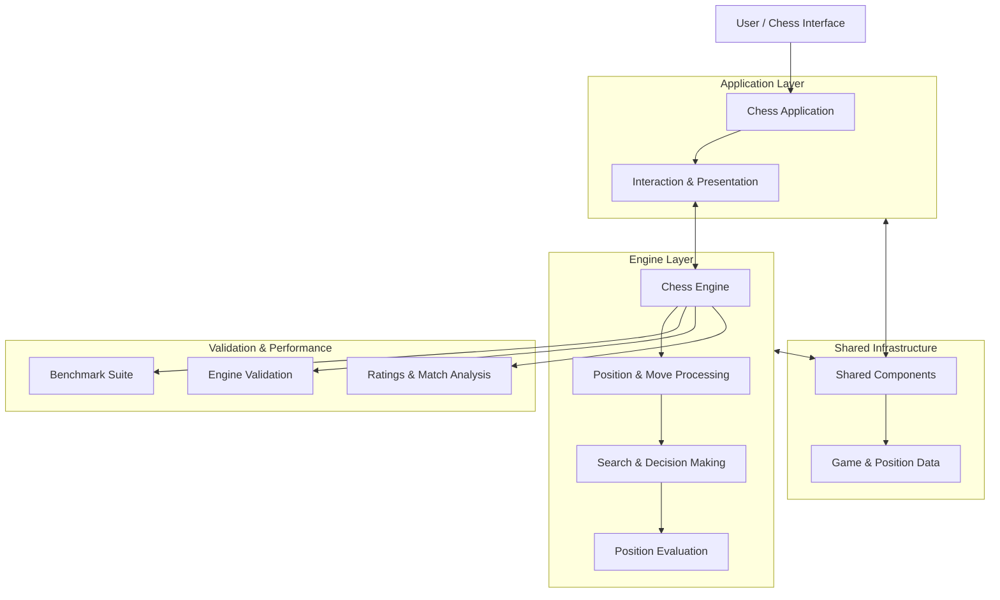

# ♟️ VANTH — Chess Engine & Analysis Platform

<p align="center">
  <strong>A ground-up chess engine engineering project focused on intelligent search, position evaluation, performance optimization, and measurable playing strength.</strong>
</p>

<p align="center">
  
  
  
  
  
</p>

<p align="center">
  <a href="https://github.com/Sahiltripathy005/Vanth-Chess-Engine">Repository</a> ·
  <a href="https://github.com/Sahiltripathy005/Vanth-Chess-Engine/issues">Issues</a> ·
  <a href="https://github.com/Sahiltripathy005/Vanth-Chess-Engine/commits">Commit History</a>
</p>

---

## Overview

**Vanth** is an independently developed chess-engine and analysis project built around one central idea: understanding, engineering, and optimizing the computational processes behind chess intelligence.

Rather than treating chess as simply a board game with an AI opponent, Vanth approaches it as a systems engineering problem involving state representation, legal move generation, combinatorial search, positional evaluation, computational efficiency, and empirical validation.

The project brings together a dedicated engine implementation, application-level components, shared infrastructure, and a performance evaluation ecosystem.

Its development emphasizes more than producing playable moves. It focuses on understanding why a position is evaluated a certain way, how search decisions are reached, where computational resources are spent, and how improvements can be measured rather than assumed.

Vanth is designed as an evolving engineering platform, with an architecture that separates the chess engine from its surrounding application and supporting infrastructure.

## Engineering Philosophy

The development of Vanth follows four principles:

- **Build, don't outsource:** Core chess-engine functionality is developed as an engineering problem rather than hiding its complexity behind a third-party chess AI.
- **Measure, don't assume:** Performance changes and engine improvements should be supported by benchmarks, validation reports, and repeatable experiments.
- **Separate concerns:** Engine logic, application interfaces, and shared components are maintained as distinct parts of the system.
- **Optimize with evidence:** Correctness comes first; optimization follows profiling, experimentation, and comparison.

---

## System Architecture

Vanth is organized around three primary components:



### Architectural components

| Component | Responsibility |
|---|---|
| `engine/` | Core chess-engine implementation and computational logic |
| `apps/` | Application-facing components and user interaction |
| `shared/` | Common functionality and shared infrastructure |
| `build/` | Build configuration and generated build artifacts |
| Benchmark artifacts | Performance measurement and comparison |
| Validation artifacts | Engine correctness and validation results |

The separation enables engine-level development without unnecessarily coupling computational logic to application presentation.

---

## Core Engineering Areas

### 1. Chess Engine Development

The engine is the computational foundation of Vanth.

It is responsible for analyzing chess positions and determining candidate moves through the underlying chess-engine logic.

The engine development work covers the fundamental challenges of computational chess:

- Chess position representation and state management.
- Piece movement and legal move processing.
- Game-state transitions.
- Position analysis and decision-making.
- Search-space exploration.
- Evaluation of candidate positions.
- Computational performance optimization.

The engine is designed to be developed and evaluated independently of the application layer.

### 2. Search and Decision-Making

Chess search is one of the most computationally demanding parts of an engine.

A chess position can lead to an enormous number of possible continuations. Efficient search therefore requires more than simply exploring every possible move.

Vanth's search engineering focuses on making the analysis process increasingly efficient while preserving decision quality.

The broader engineering considerations include:

- Search-tree exploration.
- Candidate move prioritization.
- Search efficiency.
- Position-dependent decision-making.
- Avoiding unnecessary computation.
- Improving the quality of explored variations.

### 3. Position Evaluation

A chess engine must distinguish between positions that are materially similar but strategically very different.

Position evaluation is concerned with assigning meaningful assessments to board states and helping the search process identify promising continuations.

The evaluation subsystem is an important area for experimentation, refinement, and performance analysis.

### 4. Performance Engineering

Engine performance is not measured solely by how quickly an application launches or how responsive its interface feels.

The computational workload of chess analysis introduces its own performance challenges.

Vanth maintains dedicated benchmark artifacts to support performance investigations and comparisons.

The repository includes:

- `benchmark_results.csv`
- `benchmark_results.json`
- `benchmark_results.txt`
- `comparison_results.csv`
- `comparison.log`
- `search_heatmap.json`

These artifacts provide a foundation for analyzing engine behavior, comparing experimental results, and identifying opportunities for optimization.

### 5. Engine Validation

Correctness is essential in chess-engine development.

An incorrect state transition, invalid move, or subtle rules implementation error can affect every subsequent search decision.

Vanth maintains validation-related artifacts, including:

- `engine_validation_report.json`
- `validate_output.txt`
- `positions.txt`
- `match_games.pgn`

These support the broader validation workflow across positions, games, and engine behavior.

---

## Benchmarking & Experimental Infrastructure

A distinguishing aspect of Vanth is its emphasis on empirical engineering.

Instead of treating optimization as an informal process, the project maintains structured outputs for performance measurement and comparison.

### Benchmark data

| Artifact | Purpose |
|---|---|
| `benchmark_results.csv` | Tabular benchmark observations |
| `benchmark_results.json` | Structured benchmark data |
| `benchmark_results.txt` | Human-readable benchmark output |
| `comparison_results.csv` | Comparative performance results |
| `comparison.log` | Comparison execution records |
| `search_heatmap.json` | Search-related analytical data |

### Validation and game data

| Artifact | Purpose |
|---|---|
| `engine_validation_report.json` | Engine validation results |
| `validate_output.txt` | Validation execution output |
| `positions.txt` | Chess position dataset |
| `match_games.pgn` | Recorded chess games |
| `ratings_db.json` | Rating-related records |

### Why this matters

The goal is to make engine development measurable.

A change should not automatically be considered an improvement simply because it produces a different move or appears faster in an isolated run.

A meaningful evaluation considers:

1. Whether the change preserves correctness.
2. Whether computational performance improves.
3. Whether playing decisions improve or regress.
4. Whether the results are reproducible.
5. Whether the trade-offs justify the implementation complexity.

This experimental approach provides a foundation for systematic engine development.

---

## Repository Structure

```text
Vanth-Chess-Engine/
│
├── apps/
│   └── Application-level components
│
├── engine/
│   └── Core chess-engine implementation
│
├── shared/
│   └── Shared modules and infrastructure
│
├── build/
│   └── Build configuration and artifacts
│
├── out/
│   └── Generated build output
│
├── benchmark_results.csv
├── benchmark_results.json
├── benchmark_results.txt
│
├── comparison_results.csv
├── comparison.log
│
├── engine_validation_report.json
├── validate_output.txt
│
├── positions.txt
├── match_games.pgn
├── ratings_db.json
├── search_heatmap.json
│
├── docker-compose.yml
├── package.json
├── package-lock.json
└── .gitignore
```

---

## Technology & Tooling

The project combines native engine development with application-level tooling.

| Technology | Role |
|---|---|
| C++ | Native engine development |
| JavaScript / Node.js | Application tooling and ecosystem |
| CMake / Native build tooling | Engine build infrastructure |
| JSON | Structured engine and experimental data |
| CSV | Benchmark and comparison datasets |
| PGN | Chess game recording |
| Docker Compose | Supporting development infrastructure |
| Git | Version control and development history |

---

## Getting Started

### Prerequisites

The development environment should include:

- Git
- A compatible C++ compiler
- CMake and the required native build tooling
- Node.js and npm
- Visual Studio with C++ development support on Windows, where required by the configured build

### Clone the repository

```bash
git clone https://github.com/Sahiltripathy005/Vanth-Chess-Engine.git

cd Vanth-Chess-Engine
```

### Install application dependencies

```bash
npm ci
```

### Build the native engine

Use the repository
